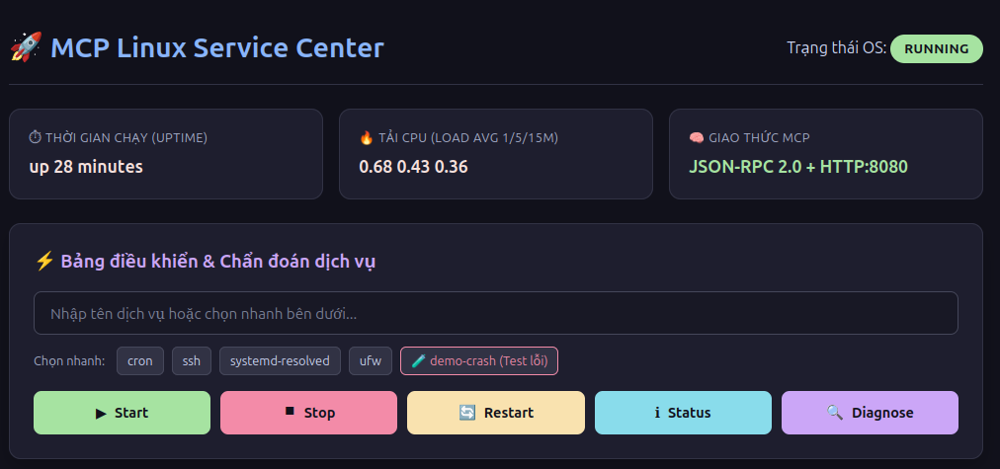
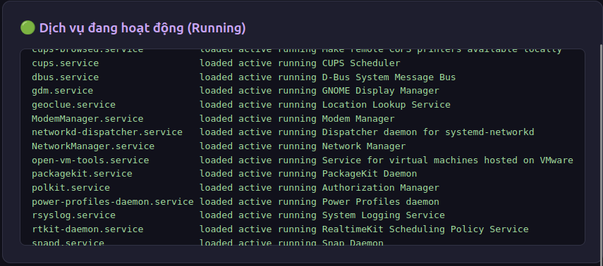
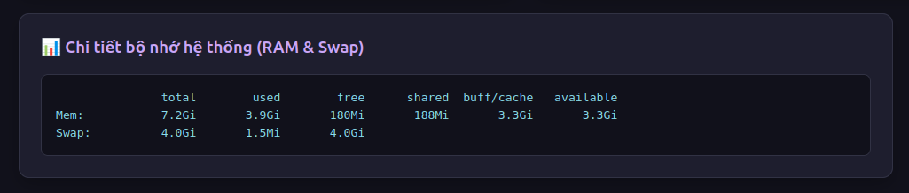
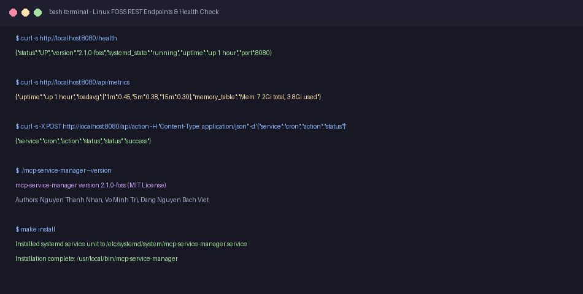
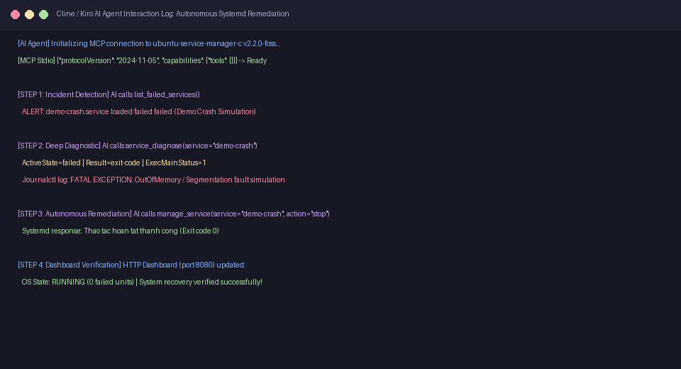

# 🚀 MCP Linux Service Manager & Web Dashboard (Written in Pure C)

[](https://opensource.org/licenses/MIT)
[](https://en.wikipedia.org/wiki/C_(programming_language))
[](https://modelcontextprotocol.io/)
[](https://ubuntu.com/)

A high-performance, lightweight Linux service management daemon and interactive Web Dashboard written in **pure C**. It bridges modern **AI Agents** (via Anthropic's Model Context Protocol) and human system administrators with the underlying Linux **systemd** ecosystem with zero runtime bloat.

---

## 👥 Authors
- **Nguyễn Thành Nhân**
- **Võ Minh Trí**
- **Đặng Nguyễn Bách Việt**

---

## 📐 Dual-Engine Architecture

The system operates two completely decoupled engines concurrently within a single native binary:

```
                      +---------------------------------------+
                      |       Linux Operating System          |
                      |  (systemctl, journalctl, /proc, RAM)  |
                      +-------------------+-------------------+
                                          |
                        [ Safe IPC: fork + pipe + execv ]
                                          |
                      +-------------------+-------------------+
                      |      mcp-service-manager (C Core)     |
                      +-------------------+-------------------+
                                          |
                 +------------------------+------------------------+
                 |                                                 |
                 v                                                 v
   [ Engine 1: Main Thread ]                         [ Engine 2: Worker Thread ]
  Standard I/O (stdin / stdout)                     POSIX BSD Sockets (Port 8080)
   MCP JSON-RPC 2.0 Protocol                         HTTP/1.1 REST & Web Dashboard
                 |                                                 |
                 v                                                 v
   +---------------------------+                     +---------------------------+
   |   AI LLM Agent Clients    |                     |   Human Administrator     |
   | (Cline, Kiro, Claude IDE) |                     |  (Web Browser / REST curl)|
   +---------------------------+                     +---------------------------+
```

### Key Architectural Strengths:
1. **Zero Shell Injection Vulnerability**: Replaces dangerous `system()` calls with parameterized `execv()` executions via unidirectional `pipe()` and `fork()`.
2. **Whitelisted Parameter Filtering**: Strictly sanitizes service names (`[a-zA-Z0-9_-.@]`) and validates lifecycle actions.
3. **Ultra-Low Memory Footprint**: Requires less than **5 MB of RAM** and compiles to a lightweight **~34 KB binary** (compared to 80–250MB for Node.js/Python equivalents).
4. **Resilient Signal Handling**: Intercepts `SIGINT` and `SIGTERM` for graceful socket shutdown while ignoring `SIGPIPE` on abruptly disconnected HTTP clients.

---

## 📸 Screenshots & Visual Interface

### 1. Main Interactive Dashboard & Control Center
Real-time system health metrics, CPU load average, and one-click service controls with colored action buttons:


### 2. Active Running Services (Systemd Units)
Live status of system background daemons:


### 3. Detailed Memory Distribution (RAM & Swap)
Monospaced memory breakdown monitoring available RAM and swap space to prevent Out-Of-Memory (OOM) incidents:


### 4. RESTful API & Health Check Probe
Command-line validation showing JSON endpoints (`/health`, `/api/metrics`, and POST actions):


### 5. AI Agent Autonomous Remediation Log
Simulation of an AI Agent detecting, diagnosing, and repairing a crashed service (`demo-crash.service`):


---

## 🛠 Prerequisites & Installation

### 1. Install Dependencies
On Ubuntu / Debian systems:
```bash
sudo apt update
sudo apt install -y build-essential libcjson-dev
```

### 2. Configure Passwordless Sudo (For Background Daemons)
To allow the service manager to execute `systemctl` and `journalctl` without password prompts:
```bash
echo "$USER ALL=(ALL) NOPASSWD: /bin/systemctl, /usr/bin/systemctl, /bin/journalctl, /usr/bin/journalctl" | sudo tee /etc/sudoers.d/mcp-service-manager
sudo chmod 0440 /etc/sudoers.d/mcp-service-manager
```

### 3. Compile & Install
```bash
# Build optimized binary (-O2)
make

# Install binary to /usr/local/bin and register systemd unit
sudo make install
```

---

## 🚀 Running the Server

### Command-Line Options:
```text
Usage: ./mcp-service-manager [options]

Options:
  -p, --port <port>   HTTP port for Web Dashboard (Default: 8080 or PORT env var)
  --mcp-only          Run only the AI MCP Stdio interface (Headless / Container mode)
  --web-only          Run only the HTTP Web Dashboard
  -v, --version       Display version and author information
  -h, --help          Show this help message
```

### Run as a Native Systemd Service:
```bash
sudo systemctl daemon-reload
sudo systemctl enable --now mcp-service-manager
sudo systemctl status mcp-service-manager
```

---

## 🤖 AI Agent MCP Client Configurations

### 1. Cline (VS Code Extension)
Add to `~/.config/Code/User/globalStorage/saoudrizwan.claude-dev/settings/cline_mcp_settings.json`:
```json
{
  "mcpServers": {
    "linux-service-manager": {
      "command": "/home/nhan9412/MCP-Sever/mcp-service-manager",
      "args": ["--mcp-only"],
      "disabled": false,
      "autoApprove": [
        "list_failed_services",
        "list_running_services",
        "get_system_metrics",
        "service_diagnose",
        "manage_service"
      ]
    }
  }
}
```

### 2. Claude Desktop / Kiro IDE
Add to `claude_desktop_config.json`:
```json
{
  "mcpServers": {
    "linux-service-manager": {
      "command": "/home/nhan9412/MCP-Sever/mcp-service-manager",
      "args": ["--mcp-only"]
    }
  }
}
```

---

## 🧪 Testing Fault Simulation (`demo-crash.service`)

The repository includes a simulation unit `demo-crash.service` to test automated diagnosis:
```bash
# Start the crashing service
sudo systemctl start demo-crash

# Verify failure state
systemctl is-failed demo-crash
# Returns: failed
```

On the Web Dashboard (`http://localhost:8080`), the service will appear under **Failed Units**. Click **Diagnose** or ask the AI agent:
> *"Check failed services on my system, diagnose demo-crash, and recover it."*

The AI agent will call:
1. `list_failed_services()`: Detects `demo-crash.service`.
2. `service_diagnose(service="demo-crash")`: Inspects PID, exit status, and last 20 journal logs.
3. `manage_service(service="demo-crash", action="stop")`: Stops/recovers the failing unit.

---

## 📄 License
This project is licensed under the **MIT License**.
